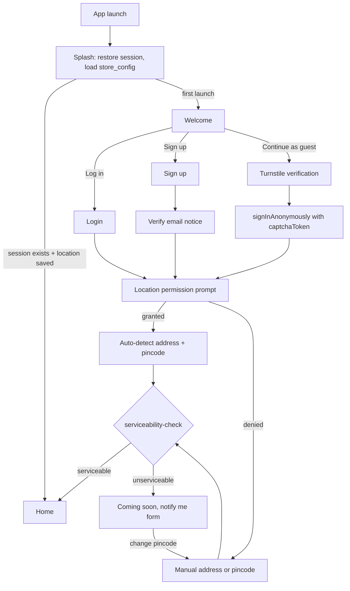
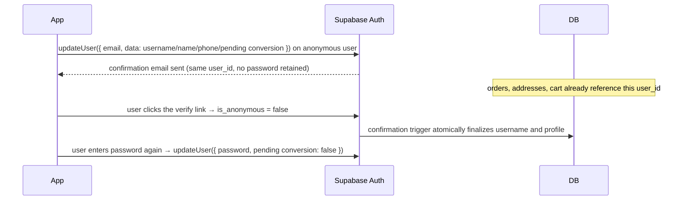
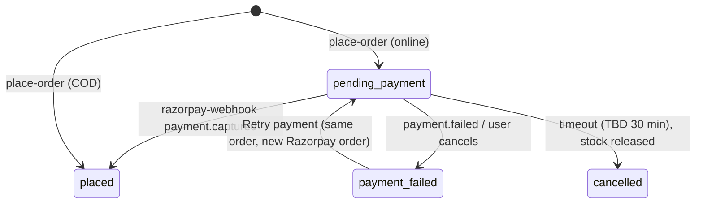
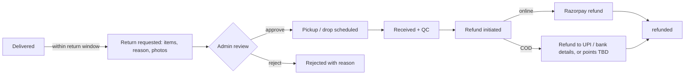

# User flows

Flows are written as steps plus Mermaid diagrams. "Server" means Postgres (RLS / RPC) or an Edge Function ([edge-functions.md](edge-functions.md)).

## 1. Onboarding

- Location denial never blocks the user. The pincode is saved locally and on `profiles.default_pincode` for registered users.
- The serviceability result is cached for the session. Home shows "Delivering to <pincode>".
- Phase 3 auth checkpoint (2026-10-13): session restoration, auth screens and Account identity/logout are implemented. Location setup is explicitly pending the required Android auth review; its temporary screen offers browsing without claiming a serviceability result. Address CRUD and serviceability UI are not yet implemented.

## 2. Guest checkout

1. The guest (anonymous session) adds items to the cart. The cart is stored server-side under the anonymous `user_id`.
2. Checkout → **Contact**: name, phone, email (zod `guestContactSchema`).
3. **Address**: a new address, saved to `addresses` for the anonymous user.
4. **Delivery type**: options for the pincode (e.g. standard / slot, TBD - owner decision).
5. **Payment**: UPI / card / wallet (Razorpay) or COD (if allowed for the pincode and order value).
6. `place-order` → order number shown → **"Create account to keep your orders"** prompt.
7. Order lookup later: order number + email or phone.

## 3. Registered checkout

Same as guest, except contact details are prefilled from `profiles`, saved addresses are offered, Vivo Points redemption is available, and Vivo price applies.

## 4. Guest → account conversion

- Supabase requires email verification before adding a password to an anonymous user. Enable manual identity linking in hosted Auth settings. The authenticated email-linking `updateUser` call has no CAPTCHA option in the SDK; it uses the already CAPTCHA-protected guest session, not a new `signUp`. Fresh signup, guest sign-in, login, reset and confirmation resend use challenge tokens.
- Never merge identities or discard the guest cart on conversion. Logging into a different existing account intentionally clears the prior local cart and query cache. Logout ends the local session and clears the cart. Server cart persistence is deferred to Phase 6.
- If the email already belongs to an account, the user logs in to that account instead, and the guest orders are **linked by email + order number** through a support/admin action (TBD - owner decision: automatic merge vs manual).

### Auth configuration for the Android review

In Supabase Auth URL Configuration, add these redirect URLs (development host verified on 2026-10-13; update it whenever the LAN IP/Expo port changes):

- `vivodha://auth-callback`
- `vivodha://auth-callback?intent=conversion`
- `vivodha://auth-callback?intent=recovery`
- `exp://172.20.10.5:8081/--/auth-callback`
- `exp://172.20.10.5:8081/--/auth-callback?intent=conversion`
- `exp://172.20.10.5:8081/--/auth-callback?intent=recovery`
- Optional browser-only development: `http://localhost:8081/auth-callback`, plus the same `?intent=conversion` and `?intent=recovery` variants.

The app derives redirects with `expo-linking.createURL`, not a hardcoded IP. The `vivodha` scheme works in installed builds; Expo Go uses the `exp` URL. Open confirmation/recovery links on the same phone. Set hosted minimum password length to 8, keep email confirmation ON, and enable manual identity linking. The local config reflects the password/linking requirements but has not been pushed to hosted Auth configuration.

The owner entered `EXPO_PUBLIC_TURNSTILE_SITE_KEY` locally. Allowlist `nzltgmfodazrhrxufpwe.supabase.co` for the default native WebView origin, and `localhost` only if testing the browser preview. Never paste keys, passwords, or email-link tokens into review feedback. Browser rendering is not Android sign-off.

### Temporary DEV CAPTCHA exception (2026-10-13)

The owner requested temporary disablement after Turnstile worked in Chrome and on Android but failed in VS Code's integrated browser, and reports CAPTCHA protection is OFF in hosted DEV Auth. This is not a production configuration or CAPTCHA sign-off.

- The ignored mobile `.env.local` sets `EXPO_PUBLIC_DEV_DISABLE_CAPTCHA=true`. The app honors it only in development builds connected to `https://nzltgmfodazrhrxufpwe.supabase.co`; other projects and production bundles still require CAPTCHA. Full-reload the app after changing the setting; restart Expo if necessary.
- The deployed `username-login` handler requires CAPTCHA unless its server-only `DEV_DISABLE_CAPTCHA=true` setting is present on that exact DEV project. The client cannot choose the server policy. Set with `pnpm supabase secrets set DEV_DISABLE_CAPTCHA=true --project-ref nzltgmfodazrhrxufpwe`, then deploy with `pnpm supabase functions deploy username-login --use-api --project-ref nzltgmfodazrhrxufpwe`.
- Guest sign-in, signup, email/username login, reset and resend omit CAPTCHA tokens and show a visible DEV-only warning instead of a widget. No fabricated verification token is used.
- Email confirmation, manual linking, anonymous sign-ins, password validation, RLS and rate limits remain unchanged. Public DEV endpoints have reduced bot protection while hosted CAPTCHA is OFF, regardless of production bundle safeguards.

**Restore before production or CAPTCHA review:**

1. Remove `EXPO_PUBLIC_DEV_DISABLE_CAPTCHA` from the ignored mobile `.env.local` (or set it to `false`) and restart Expo/full-reload.
2. Run `pnpm supabase secrets set DEV_DISABLE_CAPTCHA=false --project-ref nzltgmfodazrhrxufpwe`.
3. Re-enable CAPTCHA protection in hosted DEV Supabase Auth using the existing Turnstile configuration.
4. Repeat real verification, guest, signup, login, reset and resend checks in Chrome and Android Expo Go. Keep the existing Turnstile widget/site key/hostname configuration.

## 5. Payment outcomes

| Outcome     | User sees                                                          | System                                                                                   |
| ----------- | ------------------------------------------------------------------ | ---------------------------------------------------------------------------------------- |
| **Success** | Confirmation with order number, ETA, and points to be earned       | Webhook verifies the signature → `payments.status = captured` → `orders.status = placed` |
| **Failure** | "Payment failed" with reason, plus **Retry** and **Change method** | The order stays `pending_payment`, and stock stays reserved until the timeout            |
| **Pending** | "Confirming your payment…" with polling (the UPI collect delay)    | The client never marks an order paid; only the webhook does. The timeout job cancels     |

## 6. Cancellation

- The customer can cancel while the status is `placed` (before `packed`). After that, they contact support.
- `cancel-order`: status → `cancelled`, stock released, coupon redemption voided, redeemed points reversed (`reverse_cancel` ledger entry), and a refund is initiated for online payments.
- The admin can cancel at any status before `delivered` (with a reason).

## 7. Return & refund

- The return window is per category (perishables may be "no return, replace/refund on issue", TBD - owner decision).
- Points earned on returned items are not credited, or are reversed (`reverse_return`).

## 8. Vivo Points: earn / redeem / expiry

- **Earn.** At delivery, `floor(eligible_value / 100)` points are computed (× booster multiplier per category) and shown as _pending_. The `points-credit` job credits them after the return window ends, as an `earn_order` / `earn_booster` ledger row.
- **Redeem.** In the cart toggle, the usable amount is `min(balance, 20% of order value)`, but only if `balance ≥ 50`. `place-order` writes a `redeem_order` row (negative) atomically with the order.
- **Expiry.** The `points-expiry` job finds users with no qualifying activity for 12 months and writes an `expire` row equal to the remaining balance. A reminder notification goes out 30 days before (TBD).
- **Vivo price.** Registered members see the `variants.member_price` where set. Guests see "Vivo price ₹X, sign in to get it".

## 9. Serviceability

1. Input: pincode (from GPS reverse-geocode or manual entry).
2. `check_pincode` RPC → `{ serviceable, mode, eta_text, cod_available, min_order_paise }`.
3. Unserviceable → the notify-me form inserts into `pincode_waitlist` (one per contact + pincode). Historical `serviceability_requests` rows are retained; new client inserts are revoked.
4. The pincode is re-checked when the address changes at checkout. If the cart has items unavailable for that pincode, they are flagged.
